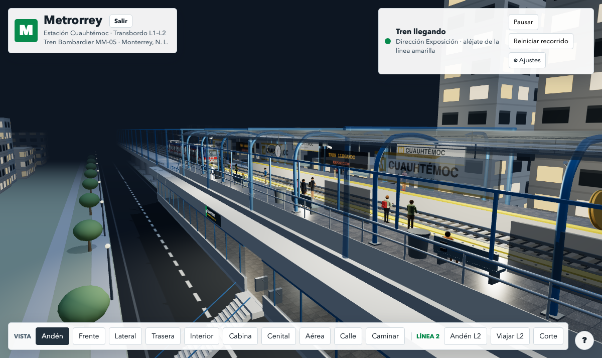

# ruta.casa — Metros de México en 3D

[](LICENSE)
[](https://ruta.casa)

**ruta.casa** es un proyecto de código abierto para recrear, en 3D y desde
el navegador, los metros y trenes ligeros de México: sus trenes, estaciones
y la vida que pasa dentro de ellos.

Hoy incluye un modelo animado y recorrible del **Metrorrey**: un tren
Bombardier MM-05 en la estación elevada Cuauhtémoc (Línea 1, transbordo
subterráneo con la Línea 2), con el Cerro de la Silla al fondo. El tren
llega, abre puertas, suben y bajan pasajeros, cierra y sale, en ciclo.

> ▶ **Pruébalo en línea:** https://ruta.casa



## ¿Qué hay hoy?

- 🚈 **Tren MM-05 con interior real**: bancas, tubos, publicidad, mapa,
  luz de techo, cabina con conductor y cristalera completa (también se
  ven los vidrios mojados con gotas resbalando cuando llueve).
- 🧑‍🤝‍🧑 **Gente con intención**: las personas llegan desde la calle por las
  escaleras, esperan, dejan bajar antes de subir, entran al vagón, se
  sientan o se agarran del tubo y viajan. Nadie aparece ni desaparece a
  la vista.
- 🎮 **Modo conductor** (vista Cabina): manejo automático o manual sobre
  una línea infinita procedural, con estaciones a 736 m, frenado suave y
  de emergencia, interlock de puertas y espejos convexos de andén. Si
  paras antes o después de la marca, la gente sube y baja por las puertas
  que queden frente al andén (corre si le quedan lejos).
- 🚶 **Primera persona** (vista Caminar): recorre el andén, sube al tren,
  baja a la conexión, sal a la calle o cruza al edificio de transbordo y
  a la Línea 2 subterránea.
- 🌦️ **Escenarios**: mediodía, amanecer, lluvia y noche (al entrar,
  siempre es de noche; el interior del vagón se ilumina con su plafón).
- ⚙️ **Techos y paredes configurables** (Auto / Visible / Transparente /
  Oculto) para ver el interior de trenes y estación desde fuera.
- 🚇 **Línea 2 subterránea**: andenes, túnel infinito, su propia gente y
  el transbordo completo de 5 niveles entre ambas líneas.

## Cómo ejecutarlo en tu computadora

No necesitas instalar nada ni tener internet: **abre `index.html` con
doble clic** en tu navegador (funciona con `file://`).

- Three.js va incluido en local (`lib/three.min.js`, r128, licencia MIT).
- No usa módulos ES ni CDN; todas las texturas se dibujan en código.

Opcional, con servidor local:

```sh
cd ruta.casa
python3 -m http.server 8123 --bind 127.0.0.1
# entra a http://127.0.0.1:8123/
```

## Controles

| Acción | Cómo |
| --- | --- |
| Girar la cámara | Arrastrar, o **flechas del teclado** (suave, varias a la vez) |
| Acercar / alejar | Rueda del ratón o pellizcar |
| Desplazar la vista | Arrastrar con botón derecho, o `Shift` + flechas |
| Cambiar de vista | Botones inferiores: Andén, Frente, Lateral, Trasera, Interior, Cabina, Cenital, Aérea, Calle, Caminar, Andén L2, Viajar L2 y Corte |
| Manejar el tren | Vista Cabina: `W/↑` acelera, `S/↓` reversa, `Espacio` frena, `E` freno de emergencia (detenido, otra vez `E` lo restablece), `O`/`C` puertas (o los botones del panel) |
| Mirar en cabina | Arrastre, o `←`/`→` (en Viajar L2 también `↑`/`↓`) |
| Caminar | Vista Caminar: `W A S D` / flechas y arrastre para mirar; «Ir a…» salta entre niveles |
| Ajustes | ⚙ arriba a la derecha: techos/paredes, clima y luz |

## 🔗 Enlaces directos (parámetros en la URL)

La barra de direcciones **siempre refleja lo que estás viendo**, así que
puedes copiar la URL y compartir la vista exacta. Al abrir ese enlace se
restaura todo: vista, cámara y ajustes.

Ejemplo:

```
https://ruta.casa/?vista=corte&escenario=noche&estacion=auto&estacionOpacidad=12&tren=visible&trenOpacidad=7&objetivo=34,-2,14&distancia=55&acimut=35&polar=55
```

| Parámetro | Qué es | Valores |
| --- | --- | --- |
| `vista` | Vista activa | `anden`, `frente`, `lateral`, `trasera`, `interior`, `cabina`, `cenital`, `aerea`, `calle`, `caminar`, `andenL2`, `viajarL2`, `corte` |
| `escenario` | Clima y luz | `mediodia`, `amanecer`, `lluvia`, `noche` |
| `estacion` / `estacionOpacidad` | Techo de la estación y su opacidad | `auto`, `visible`, `transparente`, `oculto` / `0`–`70` |
| `tren` / `trenOpacidad` | Techo y paredes del tren MM-05 | igual que arriba |
| `objetivo` | Punto al que mira la cámara (`x,y,z`) | vistas orbitales |
| `distancia` | Zoom: distancia al objetivo en metros | vistas orbitales |
| `acimut` / `polar` | Ángulos de la cámara en grados | vistas orbitales |
| `pos` | Tu posición (`x,y,z`) | solo en `caminar` |
| `yaw` / `pitch` | Hacia dónde miras, en grados | `caminar`, `cabina`, `viajarL2` |

Detalles: en **Interior** la cámara viaja con el tren, así que solo se
guardan distancia y ángulos (el objetivo se recalcula al abrir el
enlace). La URL se actualiza al instante al tocar una vista o un ajuste,
y mientras mueves la cámara a lo más cada 600 ms, sin recargar la página
ni llenar el historial. También funciona abriendo el archivo local.

## Despliegue

Push a `main` → Workers Builds publica el Worker `ruta-casa` (Cloudflare Workers Static Assets, sin código de servidor)
en [ruta.casa](https://ruta.casa). Config: [`wrangler.toml`](wrangler.toml); lo no público se excluye en
[`.assetsignore`](.assetsignore). No usar `npx wrangler deploy` a mano.

## Estructura y construcción

```
index.html            página principal y paneles
css/style.css         estilos
js/main.js            toda la escena 3D (~5 400 líneas, JS clásico, sin módulos ni build)
lib/three.min.js      Three.js r128 local
ruta/index.html       página «Roadmap» (botón Salir)
visual-plan/          PRD-MM05.md + refs/ (fotos Wikimedia; no las carga la página)
docs/                 imágenes de la documentación
pendientes.md         tareas abiertas y bitácora de lo hecho
transbordo-cuauhtemoc.md  especificación de los 5 niveles del transbordo
AGENTS.md             contexto y convenciones para agentes/LLM
wrangler.toml         despliegue
```

- **Rendimiento**: lo fijo se fusiona en una malla por material, lo repetido va instanciado, cada persona es una `SkinnedMesh`, sombras cada 2 cuadros, resolución interna adaptable.
- **Fidelidad**: el MM-05 sigue fotos de `visual-plan/refs/` (balizado, nariz achaflanada, pantógrafo de brazo único, vía en placa, interior MM-90/MM-93); ver [`visual-plan/PRD-MM05.md`](visual-plan/PRD-MM05.md).

## 🗺️ Hoja de ruta (roadmap)

La meta es que el recorrido deje de ser un tramo recto que se repite y
se convierta en líneas reales, estación por estación, y después saltar
a los demás sistemas del país. Todo ayuda: ver
[`CONTRIBUTING.md`](CONTRIBUTING.md).

### Metrorrey (Monterrey) — en curso

- [x] Estación **Cuauhtémoc** (L1) con transbordo subterráneo a la L2
- [x] Tramo elevado con vía en placa, catenaria y ciudad procedural
- [ ] **Demás estaciones de la Línea 1** (Talleres → Exposición)
  - [ ] Tramo poniente: Talleres, San Bernabé, Unidad Modelo, Aztlán,
        Penitenciaría
  - [ ] Tramo centro: Alfonso Reyes, Mitras, Simón Bolívar, Hospital,
        Edison, Central
  - [ ] Tramo oriente: Del Golfo, Félix U. Gómez, Parque Fundidora,
        Y Griega, Eloy Cavazos, Lerdo de Tejada, Exposición
  - [ ] Particularidades por estación: accesos, elevadores, entornos
        reconocibles (Parque Fundidora, Macroplaza…)
- [ ] **Línea 2 subterránea con nombres y estaciones reales**
  - [ ] Zaragoza, Padre Mier, Alameda, Fundadores
  - [ ] Colonia, Cuauhtémoc (transbordo), Del Golfo y tramo norte a Sendero
  - [ ] Estaciones elevadas del tramo a Sendero (Niños Héroes, Universidad…)
- [ ] **Línea 3** (Hospital Metropolitano → General I. Zaragoza)
  - [ ] Tren y balizado propios de la L3
  - [ ] Transbordo con la L1 en Félix U. Gómez y con la L2 en Zaragoza
- [ ] Otros trenes de Metrorrey: MM-90, MM-93, CRRC MM-20 – MM-25 y los trenes nuevos de la L3

### Curvas y recorrido real

Hoy la línea infinita es un tramo **recto** que se recicla. Lo siguiente
es trazar recorridos reales:

- [ ] Trazado por puntos (curvas horizontales) en lugar de un solo eje
- [ ] Vía en placa y durmientes que sigan la curva
- [ ] Catenaria y pórticos en curva (hilo en zigzag sobre el pantógrafo)
- [ ] Peralte (inclinación) en curvas y transiciones suaves
- [ ] Pendientes: rampas entre tramo elevado, a nivel y subterráneo
- [ ] Estaciones en curva y andenes curvos
- [ ] Agujas (cambios de vía), cruceros y vías de enlace entre líneas
- [ ] Señalamiento, límites de velocidad por tramo y frenado según trazado
- [ ] Cámara y modo conductor siguiendo el trazado completo, sin reciclaje

### Próximo sistema: Metro de la Ciudad de México (STC)

Después de Metrorrey sigue el Metro de la CDMX, línea por línea. En cada
una el trabajo base es el mismo: investigar su material rodante y sus
estaciones, modelar un tren, una estación representativa y su recorrido.

- [ ] **Línea 1 (rosa)** — Pantitlán ↔ Observatorio
  - [ ] Tren sobre neumáticos (nueva flota) y vía con barras guía
  - [ ] Estación representativa subterránea y el transbordo de Pantitlán
- [ ] **Línea 2 (azul)** — Cuatro Caminos ↔ Tasqueña
  - [ ] Tren NM-02 y tramo superficial de la calzada de Tlalpan
  - [ ] Estaciones a nivel (Villa de Cortés, Nativitas…) y Zócalo
- [ ] **Línea 3 (verde olivo)** — Indios Verdes ↔ Universidad
  - [ ] Tren y señalética propios; íconos de estación (Lance Wyman)
  - [ ] Tramo subterráneo centro y terminal Universidad
- [ ] **Línea 4 (aqua)** — Martín Carrera ↔ Santa Anita
  - [ ] Viaducto elevado ligero, el más corto de la red
  - [ ] Estaciones elevadas tipo (Talismán, Bondojito…)
- [ ] **Línea 5 (amarilla)** — Politécnico ↔ Pantitlán
  - [ ] Tramo en trinchera/superficial junto al Circuito Interior
  - [ ] Transbordos de Instituto del Petróleo y Oceanía
- [ ] **Línea 6 (roja)** — El Rosario ↔ Martín Carrera
  - [ ] Trayecto mayormente superficial y talleres de El Rosario
  - [ ] Estaciones tipo superficial (Valle Gómez, Lindavista…)
- [ ] **Línea 7 (naranja)** — El Rosario ↔ Barranca del Muerto
  - [ ] Túnel profundo (la línea más honda) y estaciones en caverna
  - [ ] Escaleras largas y andenes profundos (Barranca del Muerto)
- [ ] **Línea 8 (verde)** — Garibaldi/Lagunilla ↔ Constitución de 1917
  - [ ] Viaducto elevado sobre calzada Ermita Iztapalapa
  - [ ] Estaciones elevadas tipo (Apatlaco, Culhuacán…)
- [ ] **Línea 9 (café)** — Tacubaya ↔ Pantitlán
  - [ ] Viaducto elevado sobre el Viaducto Río de la Piedad
  - [ ] El hangar/techumbre de Pantitlán y su pasarela de transbordo
- [ ] **Línea A (morada)** — Pantitlán ↔ La Paz
  - [ ] Tren férreo (rueda de acero, catenaria) — distinto al neumático
  - [ ] Recorrido superficial por la calzada Ignacio Zaragoza
- [ ] **Línea B (gris y verde)** — Buenavista ↔ Ciudad Azteca
  - [ ] Tren férreo y tramo elevado sobre Oceanía/Aragón
  - [ ] Estaciones elevadas y cruces con el tránsito en Ecatepec
- [ ] **Línea 12 (dorada)** — Mixcoac ↔ Tláhuac
  - [ ] Tren férreo FE-10 y sus estaciones elevadas modernas
  - [ ] Tramo elevado de Tláhuac y el subterráneo a Mixcoac

Subtareas comunes a todas las líneas de la CDMX:

- [ ] Sistema neumático: barras guía, zapatas y ruedas de caucho
- [ ] Identidad visual STC: íconos, tipografía y balizados por época
- [ ] Torniquetes, taquillas y señalización de andén
- [ ] Transbordos largos entre líneas (pasillos, escaleras, niveles)

### Tren Ligero de Guadalajara (SITEUR)

- [ ] **Línea 1** — Auditorio ↔ Periférico Sur
  - [ ] Tren ligero articulado y tramo superficial con cruces a nivel
  - [ ] Estaciones a nivel y el tramo subterráneo del centro
- [ ] **Línea 2** — Juárez ↔ Tetlán
  - [ ] Recorrido subterráneo bajo Javier Mina / Juárez
  - [ ] Transbordo con la L1 en Juárez y con la L3 en Plaza Universidad
- [ ] **Línea 3** — Arcos de Zapopan ↔ Central de Autobuses
  - [ ] Viaductos elevados y trenes Metropolis
  - [ ] Estaciones elevadas modernas y transbordo en Ávila Camacho (L1)
- [ ] **Línea 4** (en construcción) — hacia Tlajomulco
  - [ ] Seguir su avance e incorporarla cuando opere

### Más a futuro

- [ ] Sonidos (ambiente de estación, llegada del tren, cierre de puertas)
- [ ] Horarios y frecuencias con reloj simulado (horas pico y valle)
- [ ] Accesibilidad en el modelo: elevadores funcionando, pisos podotáctiles
- [ ] Juego multijugador
- [ ] Otros sistemas de México (Tren Suburbano, Tren Interurbano…) si la
      comunidad lo pide

## 🤝 Cómo colaborar

¡Toda ayuda es bienvenida! No necesitas ser experto en 3D: sirve reportar
errores, corregir textos, aportar fotos de referencia (con licencia
compatible), modelar una estación o mejorar el código.

- Guía: [`CONTRIBUTING.md`](CONTRIBUTING.md) · tareas abiertas: [`pendientes.md`](pendientes.md) y la hoja de ruta de arriba ·
  convivencia: [`CODE_OF_CONDUCT.md`](CODE_OF_CONDUCT.md) · seguridad: [`SECURITY.md`](SECURITY.md).

## Licencia

El código de este repositorio se publica bajo la **licencia MIT**
(ver [`LICENSE`](LICENSE)). © 2026 Fernando Dilland.

Terceros (no cubiertos por la licencia de arriba):

- `lib/three.min.js` — Three.js r128, licencia MIT de sus autores.
- `visual-plan/refs/` — fotografías de referencia de Wikimedia Commons;
  cada una conserva la licencia de su autor. **No se relicencian como
  MIT**; si reutilizas el repositorio, verifica la licencia de cada foto.
- Nombres, logotipos y balizados de Metrorrey, STC Metro y SITEUR son
  marcas de sus organismos. Este es un proyecto de aficionados, sin
  afiliación ni fines de lucro.

<!-- flujo-pc-readme:inicio -->
## Desarrollo y despliegue

Se prueba, compila y despliega desde la Computadora (Debian) con `dev` (empieza con `dev contexto`): los comandos de este repo están en el bloque «Flujo de trabajo» de [`AGENTS.md`](AGENTS.md) y la guía completa en `~/git/Personal/sistema.fernandodilland/docs/desarrollo/README.md` (repo `fernandodilland/sistema`).
<!-- flujo-pc-readme:fin -->
